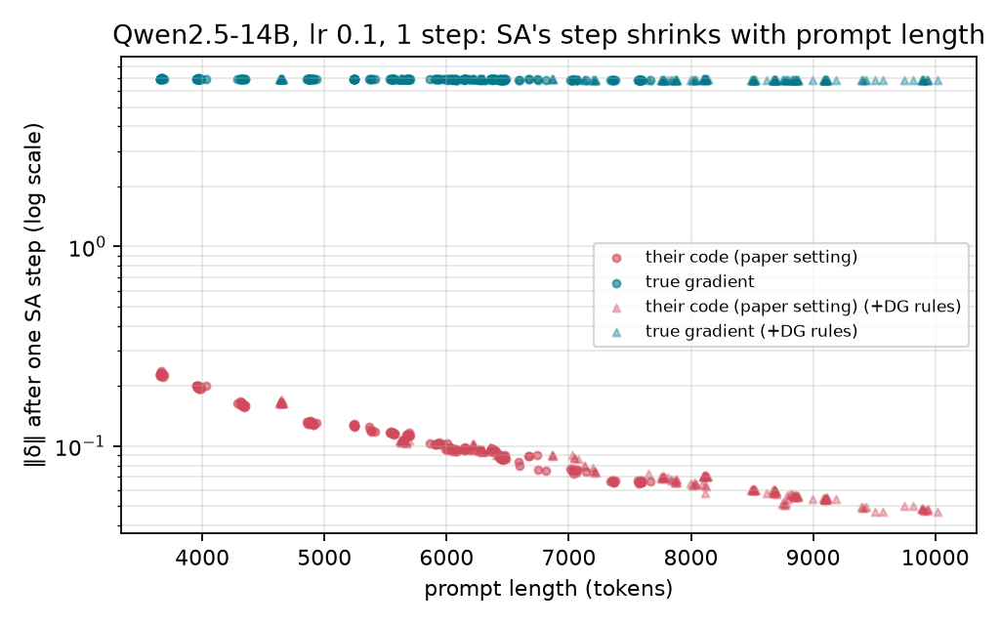
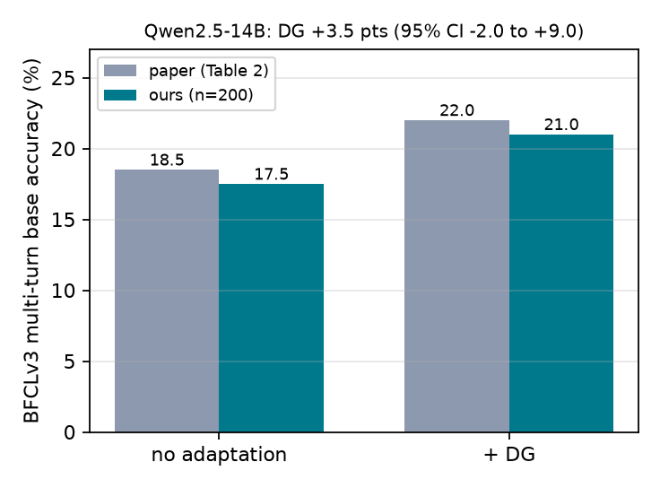

# Reproducing GTTA on BFCLv3

An independent reproduction of both methods in *Test-Time Adaptation for LLM Agents via Environment Interaction* (GTTA; Chen et al., ICLR 2026; [arXiv 2511.04847](https://arxiv.org/abs/2511.04847); code [r2llab/GTTA](https://github.com/r2llab/GTTA) at commit `24ba304`). I used the paper's open model (**Qwen2.5-14B-Instruct**, bf16), its benchmark (**BFCLv3 multi-turn base**, the authors' 200-task split), and the released code, data and prompts.

- **Project site:** [nathyb-gtta-sa-explorer.hf.space](https://nathyb-gtta-sa-explorer.hf.space): the results, the **SA Inspector** (live: run SA yourself on Qwen2.5-1.5B or 14B) and the **DG Inspector** (pre-computed from the saved runs).
- **Code:** [github.com/nathyBekele/reproducing-gtta](https://github.com/nathyBekele/reproducing-gtta) (this repository).
- **Report:** [report/main.pdf](report/main.pdf) (2 pages).
- **Research log:** [notes/decisions.md](notes/decisions.md), every choice, deviation and result in order.

## Findings

| Qwen2.5-14B, BFCLv3 (200 tasks) | paper | this reproduction |
|---|---|---|
| No adaptation | 18.5% | 17.5–18.5% (4 runs) |
| **Dynamics Grounding (DG)** | 22.0% | **21.0–22.0%** (3 runs; +3.5, +3.5, +4.0 within each run) |
| **Syntactic Alignment (SA)**, lr 0.1 × 1 step (paper default) | – | **+0.0 points** vs. no SA (SA changed generated tokens in 53/200 tasks, never an outcome) |
| SA, lr 1.0 × 3 steps (paper's best 14B setting) | – | **+0.5 points**, 95% CI [−2.5, +3.5] (5 wins, 4 losses) |

1. **DG reproduces.** Scores move by about 1 point between identical runs, and DG's gain is larger in every run. Per task the effect is stable: DG solves 16 tasks in all 3 runs that no adaptation never solves, and loses 11 the other way.
2. **SA didn't change task success.** A possible reason:
   - SA adds a vector δ to the final hidden states, which amounts to a fixed score `b = δ·Wᵀ` on every vocabulary token, so its effect can be read directly.
   - The released gradient is averaged over the prompt twice (`/ num_valid`, then `.mean(0)`). On BFCL's 4K–8K-token prompts every coordinate then falls below Adam's ε = 10⁻⁶, so the step is about **64× smaller** than Adam would normally take, and it shrinks as the prompt gets longer (Spearman −0.99).
   - The tokens SA pushes up are the prompt's most frequent text (`.`, newlines, `,`, and "Note", from the "Note that the provided function is in Python 3 syntax" line in every function's documentation). Only 3–8% of them appear in the correct call, and SA doesn't make the correct first call more likely at either setting.
3. **SA + DG.** DG's rules make prompts 36% longer, which shrinks SA's step further (0.65×). This may be one reason the paper's simple SA+DG combination didn't beat DG alone.

<p align="center">
  
  
</p>

## What differs from the paper
- **SA engine.** The original SA runs inside a patched vLLM server that keeps one δ for the whole batch. I ran it in my own greedy PyTorch loop with one δ per task, following the released schedule (reset at the first call of each user turn, Adam steps on the whole prompt at every call, δ added while decoding), and compared it only with no SA in the same loop. That loop scores 1–2 points above vLLM overall.
- **DG models.** Qwen2.5-14B explored, wrote and filtered its own rules (the paper's main setup used GPT-4.1, GPT-4o and o3).
- **Exploration parsing.** During exploration only, I execute the first valid call line, because Qwen often writes several per step. Evaluation uses BFCL's decoder and checker unchanged.
- One benchmark only; WebArena may behave differently. Predictions weren't pre-registered.

## Repository
```
sa/            library: prompts and data, SA math (alignment.py, engine_torch.py), DG pipeline (dg.py),
               SA inside the agent loop (agent_sa.py), live-demo computation (live.py)
scripts/       experiments: modal_run.py (SA likelihood), modal_dg.py (DG and noise repeats), modal_sa_agent.py (SA task success)
               analysis and figures: analyze.py, analyze_sa_agent.py, make_figures.py, make_note_figures.py
               site: export_explorer.py, export_dg_inspector.py, export_live_tasks.py, build_space.py, modal_live.py
tests/         test_alignment.py (released gradient vs. a line-by-line port, exact gradient vs. autograd, …)
third_party/   BFCL decoder, checker and API simulators, vendored from GTTA @ 24ba304
data/bfcl_v3/  GTTA's BFCLv3 tasks and split, exploration goals and DG prompts
results/       summary/ (SA likelihood), raw/ (per-task records), dg/ (DG runs and repeats),
               sa_agent/ (SA task success), logs/ (run logs)
report/        note.html → main.pdf (bash scripts/build_note_pdf.sh), figures/
explorer/      the website's pages (open explorer/index.html locally; the SA Inspector needs the server)
space/         the Hugging Face Space: app.py (Gradio entry point) and server.py (pages and API)
notes/         decisions.md (research log)
```

## Reproduce
Every GPU job ran on [Modal](https://modal.com) with a hard timeout; all experiments together cost about $13.
```bash
python -m pip install -r requirements.txt
python -m pytest tests/                                     # SA math checks (CPU)

# SA: likelihood of the correct first call (Phase 1) and the paper's best setting
modal run scripts/modal_run.py --model Qwen/Qwen2.5-14B-Instruct --tag qwen2.5-14b-bf16 --gpu H100 --timeout-min 60
modal run scripts/modal_run.py --model Qwen/Qwen2.5-14B-Instruct --tag qwen2.5-14b-bf16 --settings "1.0:1,1.0:3" --gpu H100 --timeout-min 60

# DG: explore → write rules → filter → evaluate; then two repeats with the same rules
modal run scripts/modal_dg.py --model Qwen/Qwen2.5-14B-Instruct --tag dg-14b --gpu H100 --timeout-min 60
modal run scripts/modal_dg.py --model Qwen/Qwen2.5-14B-Instruct --tag dg-14b-noise --gpu H100 --rules results/dg/dg-14b/dynamics.json --repeats 2 --timeout-min 40

# SA inside the agent loop (task success)
modal run scripts/modal_sa_agent.py --model Qwen/Qwen2.5-14B-Instruct --tag sa-agent-14b --gpu L40S --shards 4 --mode track --timeout-min 60
modal run scripts/modal_sa_agent.py --model Qwen/Qwen2.5-14B-Instruct --tag sa-agent-14b --gpu L40S --shards 4 --mode full --conditions sa_paper:1.0:3 --timeout-min 60
modal run scripts/modal_sa_agent.py --model Qwen/Qwen2.5-14B-Instruct --tag sa-agent-14b --gpu L40S --shards 4 --mode rerun --conditions sa_paper:0.1:1 --timeout-min 40

# summaries, figures, report and site data
python scripts/analyze.py --tag qwen2.5-14b-bf16 && python scripts/analyze_sa_agent.py
python scripts/make_figures.py && bash scripts/build_note_pdf.sh
python scripts/export_explorer.py && python scripts/export_dg_inspector.py && python scripts/export_live_tasks.py
```

## Running the site yourself
`python scripts/build_space.py` assembles `space/`. The SA Inspector runs SA either on Modal GPUs (`modal deploy scripts/modal_live.py`, then set `SA_BACKEND=modal`, `MODAL_URL` and `SA_LIVE_TOKEN` on the Space; the token must match the Modal secret `sa-live-token`) or on the Space's own CPU (`SA_BACKEND=local`). See `space/README.md` for all settings.

## License
Code: MIT ([LICENSE](LICENSE)). The BFCLv3 data, GTTA prompts and vendored BFCL code keep their own licenses (MIT and Apache-2.0); see [THIRD_PARTY_NOTICES.md](THIRD_PARTY_NOTICES.md). Independent reproduction, not affiliated with the GTTA authors.
